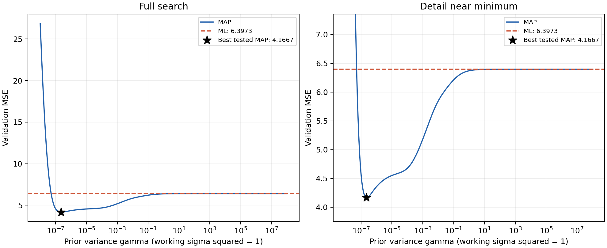
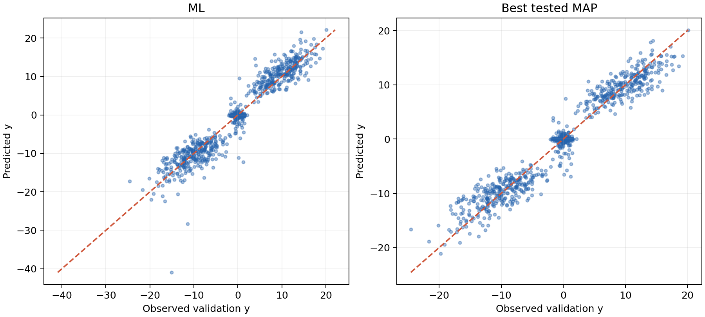

# Question 2 — ML and MAP cubic regression

## 1. Model and feature representation

Let x=(x1,x2)^T and use all monomials of total degree at most three:

\[
\phi(x)=[1,x_1,x_2,x_1^2,x_1x_2,x_2^2,x_1^3,x_1^2x_2,x_1x_2^2,x_2^3]^T.
\]

Then c(x,w)=phi(x)^T w, with ten coefficients. The design matrix Phi has row n equal to phi(x_n)^T, and y=Phi w+v. Under the stated fitting model, v is N(0,sigma^2 I), with sigma^2 positive and fixed.

## 2. Maximum-likelihood estimator

Conditioning on the inputs, independence gives

\[
p(y\mid\Phi,w)=(2\pi\sigma^2)^{-N/2}
\exp\left[-\frac{\|y-\Phi w\|^2}{2\sigma^2}\right].
\]

Terms independent of w can be dropped when maximizing the log likelihood. Thus

\[
\hat w_{ML}=\arg\min_w\|y-\Phi w\|^2.
\]

Differentiation yields the normal equations Phi^T Phi w=Phi^T y. For full column rank,

\[
\boxed{\hat w_{ML}=(\Phi^T\Phi)^{-1}\Phi^Ty}.
\]

If the design is rank deficient, Phi-dagger y is the minimum-norm ML solution. The implementation uses a least-squares solver rather than explicitly computing an inverse.

## 3. Maximum-a-posteriori estimator

The prior specified in the question is w~N(0,gamma I_10), so

\[
p(w)=(2\pi\gamma)^{-5}\exp[-\|w\|^2/(2\gamma)].
\]

Maximizing the posterior is equivalent to minimizing

\[
J(w)=\frac{1}{2\sigma^2}\|y-\Phi w\|^2+\frac{1}{2\gamma}\|w\|^2.
\]

Setting its gradient to zero gives

\[
\frac{1}{\sigma^2}\Phi^T(\Phi w-y)+\frac{1}{\gamma}w=0,
\]

and therefore

\[
\boxed{\hat w_{MAP}=\left(\Phi^T\Phi+\frac{\sigma^2}{\gamma}I_{10}\right)^{-1}\Phi^Ty}.
\]

This is ridge regression with lambda=sigma^2/gamma. The intercept is penalized too, as it is part of the vector assigned the isotropic Gaussian prior. For gamma>0, the regularized matrix is positive definite. The implementation solves the augmented least-squares problem with A_aug=[Phi; sqrt(lambda)I] and y_aug=[y;0]. The loss uses the SUM of squared residuals; using the average loss would require a penalty lambda/N for the same solution.

As gamma tends to infinity, the penalty tends to zero and MAP approaches ML (the minimum-norm ML solution in the rank-deficient case). As gamma tends to zero, all coefficients approach zero. Finite gamma may reduce prediction variance at the cost of bias.

## 4. Supplied generator and experimental assumptions

The supplied MATLAB file does NOT explicitly generate y as a fixed cubic polynomial plus independent Gaussian noise of known variance. Instead, it jointly generates (x1,x2,y) from a three-component Gaussian mixture, with probabilities (0.3,0.4,0.3), mean vectors (-10,0,10), (0,0,0), and (10,0,-10). The outer components have covariance [[1,0,-3],[0,1,0],[-3,0,15]], and the middle has diag(8,0.5,0.5).

In the left component, E[y|x,component]=-3x1-20; in the right component it is -3x1+20; in the middle it is zero. Conditional component variances are 15-9=6 for the outer components and 0.5 for the middle. The overall conditional distribution mixes these components with input-dependent weights. Consequently, it is not generally the assumed fixed-variance cubic Gaussian model. Here ML/MAP refer to fitting that working regression model, not recovering an exactly specified true cubic coefficient vector.

Because the script provides no single sigma^2, this experiment explicitly adopts sigma^2=1 as a working likelihood assumption. Only lambda=sigma^2/gamma controls the coefficient solution. If another fixed variance s^2 is required, the same fits and MSEs are recovered by replacing every gamma value by s^2 times its value here. Thus gamma itself should not be interpreted independently of this assumption.

The dataset sizes are Ntrain=100 and Nvalidate=1000, following the commented suggestions in the supplied file. A direct Python translation of its GMM distribution was used with NumPy SeedSequence(2024), spawning separate training and validation streams. This reproduces the supplied distribution but not MATLAB's exact pseudorandom sequence. All generated data are included in results/experiment.mat, so the provided MATLAB runner can reproduce the reported numerical experiment without random-number differences.

No feature standardization was applied: standardizing and then imposing an isotropic prior would change the requested prior in the original polynomial coordinates. The training design has rank 10 and condition number approximately 1837.5. Augmented least squares avoids explicitly forming the normal equations.

The hyperparameter grid contains 321 logarithmically spaced values from 10^-8 to 10^8. The problem leaves its exponents m,n unspecified; these endpoints were chosen for the experiment. All models are fitted to training samples only. Validation MSE selects the best TESTED gamma; it is not an independent test-set estimate after tuning.

## 5. Numerical results

For every model,

\[
\operatorname{MSE}_{val}=\frac{1}{1000}\sum_{i=1}^{1000}
[y_i-\phi(x_i)^T\hat w]^2.
\]

| Method | Training MSE | Validation MSE |
|---|---:|---:|
| ML | 3.281240 | 6.397256 |
| Best tested MAP | 4.187562 | 4.166744 |

The best tested prior variance and corresponding penalty are

\[
\boxed{\gamma^*=2.23872114\times10^{-7}},\qquad
\boxed{\lambda^*=4.46683592\times10^6}\quad(\sigma^2=1).
\]

MAP reduces the validation MSE by 34.8667% relative to ML in this run. At gamma=10^-8 the validation MSE is 26.877247; at gamma=10^8 it is 6.397256, matching ML to numerical accuracy. The small-gamma endpoint is not yet the exact zero-predictor limit because the raw cubic features can be large.

## 6. Discussion

The ML estimator achieves the smaller training error, but its validation MSE is 6.397256. The best tested MAP estimator accepts a larger training error while lowering validation MSE to 4.166744. This behavior is consistent with regularization reducing sensitivity to the particular training sample. The best tested gamma is inside the search interval, rather than at an endpoint.

As gamma increases, regularization becomes weaker, and the validation curve eventually approaches the ML baseline. At the smallest tested gamma the stronger penalty gives much worse validation performance. The intermediate setting provides the best observed balance for this dataset. These observations describe one reproducible realization, not a guarantee across all random datasets.

The very small selected gamma should be interpreted together with feature scaling. Inputs near plus or minus 10 create cubic features of order 1000, so a small cubic coefficient can still make substantial predictions. An isotropic coefficient penalty does not shrink all polynomial contributions equally in prediction space. At the best tested MAP setting, the x1^3 coefficient is about -0.00968244 and most other coefficients are strongly shrunk. Standardizing features would alter this result unless the prior covariance were transformed consistently.

The supplied GMM also introduces model mismatch: its conditional mean is not constrained to be a cubic polynomial and its conditional variance is not constant. Thus the experiment evaluates predictive polynomial approximation, rather than consistency for a true cubic parameter vector. Finally, since gamma was selected on these validation samples, a separate test set would be required for an unbiased post-selection performance assessment.

## 7. Run instructions and files

Python: run `python -m pip install numpy scipy matplotlib`, then `python question2_solution.py`. The program regenerates the data, all reported results, and both figures.

MATLAB: run `run_question2.m`. By default it uses the included experiment.mat and reproduces the same dataset. Its optional commented line calls the original generator to create new data; new random data will change the numerical results. The supplied generator is copied unchanged as hw2q2.m so its filename matches its main function name. Generating new data in MATLAB uses mvnrnd and requires the relevant Statistics and Machine Learning Toolbox. MATLAB code was provided but not executed in this environment; the Python experiment was executed and checked.

Full-precision coefficients and numerical diagnostics are in results/summary.json. The complete hyperparameter sweep is in results/gamma_sweep.csv. The MATLAB file contains the data and fitted parameters.
